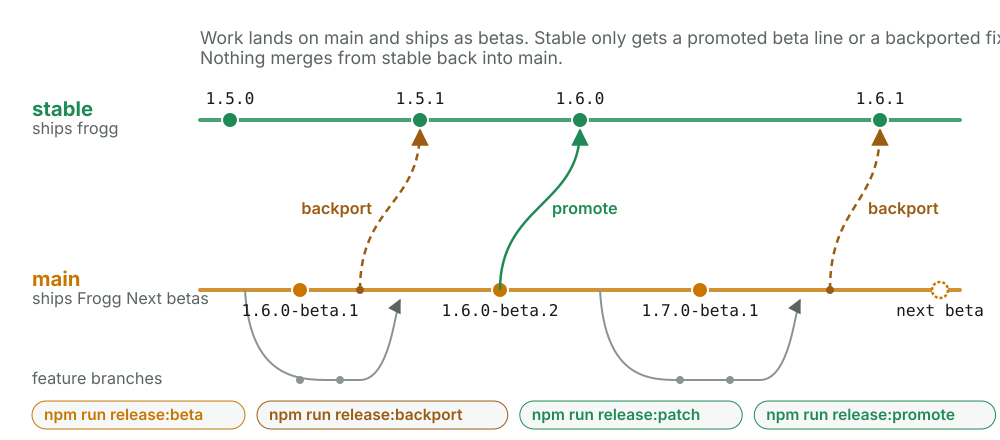
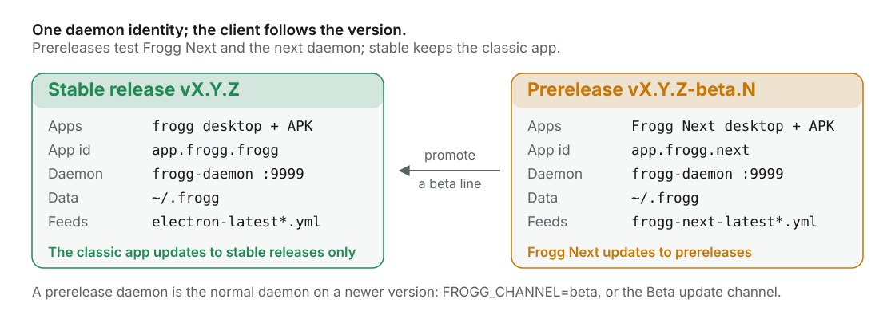
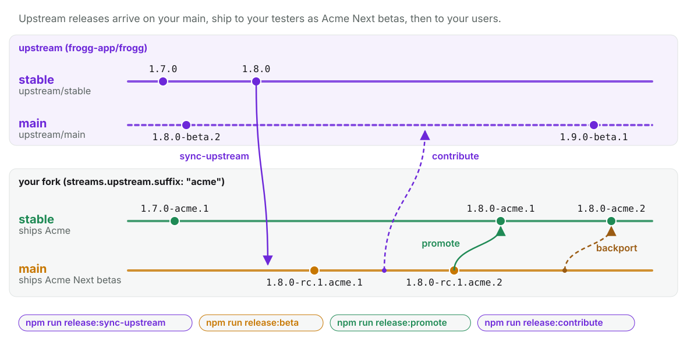
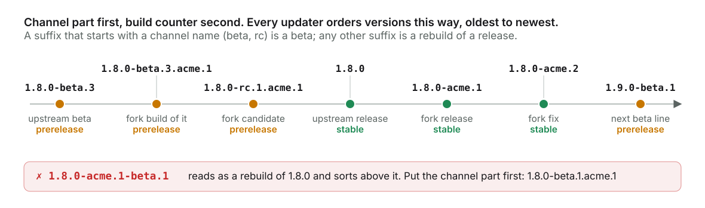

# Release streams

How frogg (and any fork of it) develops on a beta stream without disturbing stable users.
Streams are the Beta and Stable stages; before them, Development runs locally with `npm run dev:live` and publishes nothing (see the `frogg-live-dev` skill).
The full guide, with every command and option, is on the docs site:
[Release streams](https://frogg.app/docs/contributing/release-streams/). The diagrams are
generated by `node scripts/docs/stream-diagrams.mjs`.

## Two streams

<picture>
  <source media="(prefers-color-scheme: dark)" srcset="../website/src/assets/docs/diagrams/release-streams-dark.svg">
  
</picture>

| Branch   | Releases       | Carries                          | Cut with                                           |
| -------- | -------------- | -------------------------------- | -------------------------------------------------- |
| `main`   | `X.Y.Z-beta.N` | Frogg Next + the daemon          | CI after a green push, or `npm run release:beta`   |
| `stable` | `X.Y.Z`        | frogg (classic app) + the daemon | `npm run release:promote`, `npm run release:patch` |

- Work lands on `main`. Pushing `main` never reaches stable users.
- A fix stable users need now: land it on `main`, then `npm run release:backport -- <commit>`
  on `stable` and `npm run release:patch`.
- A beta line that is ready: `npm run release:promote` on `stable`. It copies `main` onto
  `stable` and cuts `X.Y.0`.
- Nothing merges from `stable` into `main`. A fix made only on `stable` blocks promotion
  until it is cherry-picked onto `main`.
- `npm run streams` shows where each stream is and what has not moved yet. In the app, open
  **+ → Release streams** for the same picture as a graph.

## What a release carries

<picture>
  <source media="(prefers-color-scheme: dark)" srcset="../website/src/assets/docs/diagrams/release-contents-dark.svg">
  
</picture>

Every build has the brand's one identity. A stable tag ships the classic app; a prerelease tag
ships Frogg Next (the brand's `next` identity, which installs beside the classic app) and the
same daemon bundles. A prerelease daemon is the normal daemon on a newer version: the Beta
update channel, `FROGG_CHANNEL=beta` or `FROGG_VERSION=<prerelease>` for `install.sh`. Run your
agents in frogg; try each beta in Frogg Next.

## Forks

<picture>
  <source media="(prefers-color-scheme: dark)" srcset="../website/src/assets/docs/diagrams/fork-streams-dark.svg">
  
</picture>

```json
{
  "streams": {
    "upstream": {
      "remote": "upstream",
      "repository": "frogg-app/frogg",
      "follow": "stable",
      "suffix": "acme"
    }
  }
}
```

1. `npm run release:sync-upstream` on `main` merges upstream's newest release.
2. `npm run release:beta` ships it to your testers as your beta (`1.8.0-rc.1.acme.1`).
3. `npm run release:promote` on `stable` ships it to your users (`1.8.0-acme.1`).
4. `npm run release:contribute -- <commit>` offers your own fixes back upstream.

## Versions

<picture>
  <source media="(prefers-color-scheme: dark)" srcset="../website/src/assets/docs/diagrams/version-order-dark.svg">
  
</picture>

A version is a beta when its suffix starts with a channel name (`beta`, `rc`, ...); any other
suffix is a fork's build counter on a stable release. The channel part always comes first:
`1.8.0-beta.1.acme.1`, never `1.8.0-acme.1-beta.1`. The rule lives in
`packages/protocol/src/release-version.ts` and `scripts/release/release-channel.mjs`, and a
test keeps the two in step.
